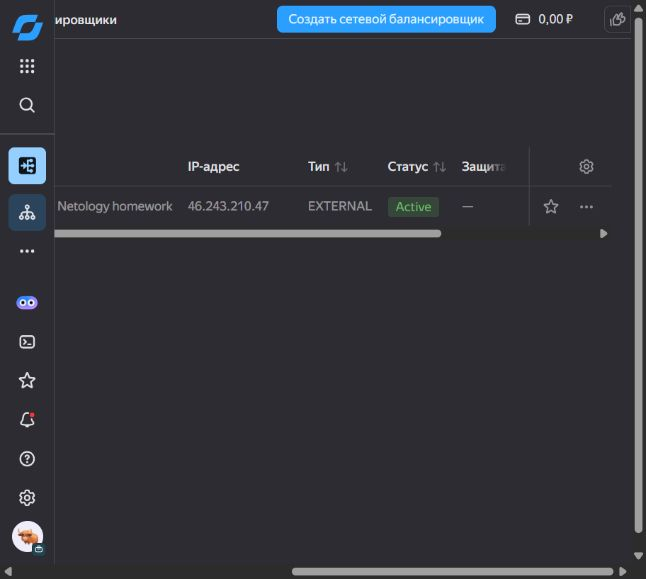
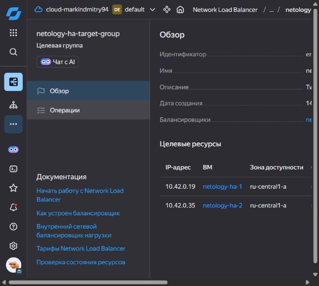
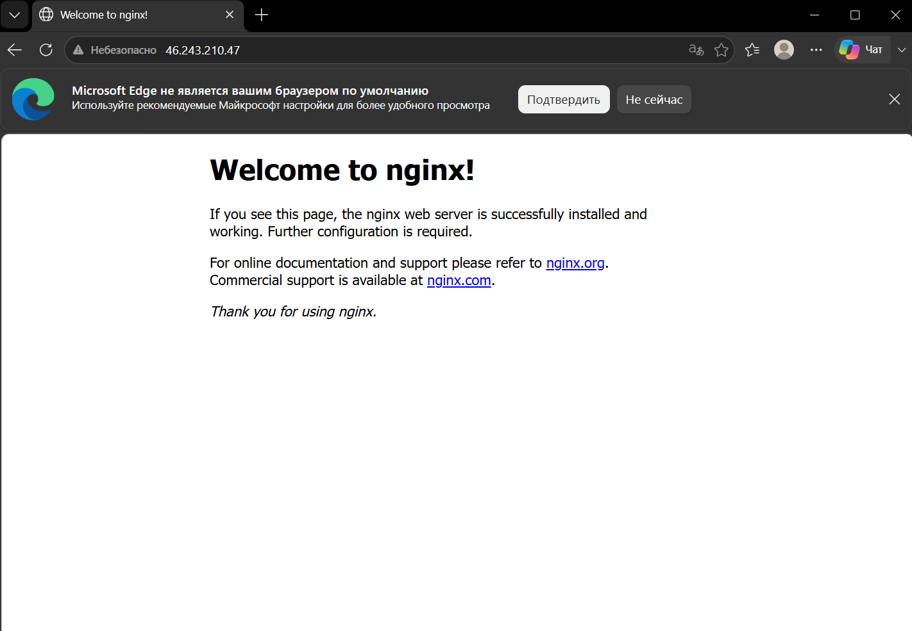

# Домашнее задание к занятию «Отказоустойчивость в облаке» — Дмитрий Маркин

Terraform-конфигурация создаёт в Yandex Cloud два одинаковых сервера Nginx с помощью `count`, целевую группу из обеих VM и внешний Network Load Balancer.

## Создаваемые ресурсы

- отдельная сеть и подсеть `netology-ha`;
- две одинаковые VM Ubuntu 22.04 LTS;
- Nginx, установленный и запущенный через `cloud-init`;
- целевая группа с внутренними IP обеих VM;
- внешний сетевой балансировщик: входящий TCP/80 → TCP/80 VM;
- HTTP-проверка состояния на порту 80 и пути `/`.

## Запуск

```bash
export YC_TOKEN="$(yc iam create-token)"
terraform init
terraform fmt -check
terraform validate
terraform plan -out=netology-ha.tfplan
terraform apply netology-ha.tfplan
```

После применения команда `terraform output nginx_url` выводит адрес для проверки страницы Nginx.

## Результат проверки

Инфраструктура развёрнута и проверена 14 ноября 2026 года до остановки виртуальных машин.

- балансировщик `netology-ha-nlb` имеет статус `Active`;
- внешний IP балансировщика: `46.243.210.47`;
- целевая группа содержит VM `netology-ha-1` (`10.42.0.19`) и `netology-ha-2` (`10.42.0.35`);
- обе цели имеют статус `HEALTHY`;
- запрос к `http://46.243.210.47` возвращает HTTP `200` и стандартную страницу Nginx.

После завершения проверки виртуальные машины остановлены для экономии средств гранта. Поэтому внешний IP балансировщика недоступен, пока VM не запущены повторно.

### Подтверждающие снимки








Задание со звёздочкой не выполняется.

